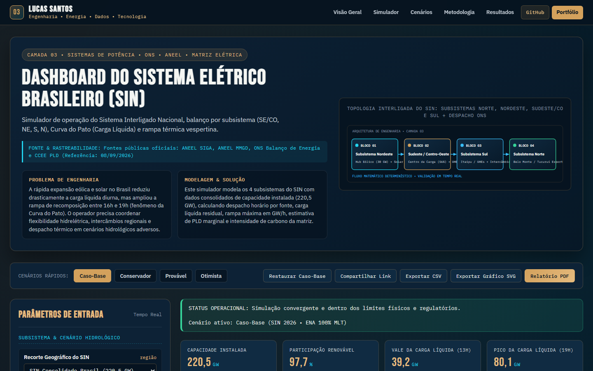

# Dashboard do Sistema Elétrico Brasileiro (SIN)

> **Camada 03 do Ecossistema de Engenharia Interativa V3 • Sistemas de Potência • ONS • ANEEL • Matriz Elétrica**  
> Simulador de operação do Sistema Interligado Nacional, balanço por subsistema (SE/CO, NE, S, N), Curva do Pato (Carga Líquida) e rampa térmica vespertina.

[](https://luscaarmstrong1.github.io/brazilian-power-system-dashboard/)
[](https://github.com/luscaarmstrong1/brazilian-power-system-dashboard)
[](https://luscaarmstrong1.github.io/brazilian-power-system-dashboard/)
[](https://lucassantos.eng.br/#arquitetura)
[](https://github.com/luscaarmstrong1/brazilian-power-system-dashboard)

---

## 1. Resumo Executivo

Este repositório integra o ecossistema de **Engenharia Interativa V3** de **Lucas Santos**, combinando modelagem física e técnico-econômica em Python com um **Simulador Web Interativo publicado no GitHub Pages** ([https://luscaarmstrong1.github.io/brazilian-power-system-dashboard/](https://luscaarmstrong1.github.io/brazilian-power-system-dashboard/)).

- **Rastreabilidade dos Dados e Modelo:** Fontes públicas oficiais: ANEEL SIGA, ANEEL MMGD, ONS Balanço de Energia e CCEE PLD (Referência: 08/09/2026).
- **Aplicação Web Autônoma:** Executa integralmente no navegador sem dependências externas frágeis, com validação de fronteira, comparador multicenário e exportação técnica (CSV, SVG e Relatório PDF).

---

## 2. Problema de Engenharia Abordado

A rápida expansão eólica e solar no Brasil reduziu drasticamente a carga líquida diurna, mas ampliou a rampa de recomposição entre 16h e 19h (fenômeno da Curva do Pato). O operador precisa coordenar flexibilidade hidrelétrica, intercâmbios regionais e despacho térmico em cenários hidrológicos adversos.

---

## 3. Solução Proposta

Este simulador modela os 4 subsistemas do SIN com dados consolidados de capacidade instalada (220,5 GW), calculando despacho horário por fonte, carga líquida residual, rampa máxima em GW/h, estimativa de PLD marginal e intensidade de carbono da matriz.

---

## 4. Funcionalidades Principais da Aplicação Interativa (V3)

1. **Painel Paramétrico Sincronizado (Slider + Input Numérico):** Controles duplos bidirecionais agrupados por domínio físico, operacional e econômico, com validação contra valores inválidos (`NaN`, `Infinity` ou fora de faixa).
2. **Motor Matemático Determinístico Auditado:** Recálculo instantâneo de todos os indicadores-chave (KPIs), balanços energéticos e séries temporais/financeiras.
3. **Múltiplas Visualizações Gráficas em Alta Nitidez (SVG):** Abas dedicadas com gráficos vetoriais responsivos e tooltips informativos.
4. **Comparador Multicenário Lado a Lado:** Comparação simultânea entre **Caso-Base**, **Conservador**, **Provável**, **Otimista** e a **Simulação Atual** do usuário.
5. **Diagnóstico Técnico Automatizado:** Geração dinâmica de alertas operacionais e recomendações de engenharia conforme os parâmetros configurados.
6. **Exportação e Compartilhamento:**
   - **Compartilhar Link:** Codifica todos os parâmetros na URL (`?param=valor`) para reprodutibilidade exata.
   - **Exportar CSV:** Download imediato da tabela de memória de cálculo.
   - **Exportar Gráfico SVG:** Download vetorial do gráfico ativo.
   - **Relatório PDF:** Folha de estilo dedicada para impressão técnica.

---

## 5. Demonstração Visual (Captura Real V3)



- **Acesse o Simulador Interativo:** [https://luscaarmstrong1.github.io/brazilian-power-system-dashboard/](https://luscaarmstrong1.github.io/brazilian-power-system-dashboard/)
- **Voltar à Seção #arquitetura no Portfólio:** [https://lucassantos.eng.br/#arquitetura](https://lucassantos.eng.br/#arquitetura)

---

## 6. Arquitetura Técnica e Fluxo de Dados

```text
[Parâmetros do Usuário / Presets de Cenário]
                 │
                 ▼
[Validação de Fronteira & Normalização Física]
                 │
                 ▼
[Motor Matemático Determinístico (Python & JS Engine V3)]
                 │
     ┌───────────┼───────────┐
     ▼           ▼           ▼
[KPI Cards] [Gráficos SVG] [Matriz Multicenário & Exportação CSV/PDF]
```

---

## 7. Metodologia e Equações Governantes

### 9.1. Carga Líquida Operacional (Fenômeno da Curva do Pato)

```text
L_liquida(t) = L_bruta(t) - G_solar(t) - G_eolica(t)
```

Representa a parcela da demanda do SIN que precisa ser suprida por fontes despacháveis (usinas hidrelétricas com reservatório, termelétricas e nucleares).

### 9.2. Taxa Máxima de Rampa Vespertina

```text
ΔR_max = max_t [ L_liquida(t+1) - L_liquida(t) ]   (em GW/h)
```

Mede a velocidade de tomada de carga necessária ao entardecer quando a geração solar cai a zero simultaneamente à entrada da ponta residencial/comercial.

### 9.3. Balanço de Potência do Sistema Interligado

```text
G_hidro(t) + G_eolica(t) + G_solar(t) + G_termica(t) + G_nuclear(t) = L_bruta(t)
```

Em conformidade com os dados públicos da ANEEL (SIGA/MMGD) e ONS de 08/09/2026.

---

## 8. Premissas e Limitações do Modelo

- **Escopo Analítico:** Os resultados constituem estudos preliminares de engenharia e viabilidade técnico-econômica. Projetos executivos requerem medições locais de campanha, estudos de curto-circuito/coordenação de proteção e parecer formal da concessionária ou ONS/CCEE.
- **Conservação Física:** Nenhuma eficiência excede 100%, nenhum despacho de bateria viola `[SOC_min, SOC_max]` e todas as séries respeitam limites físicos estritos.

---

## 9. Parâmetros de Entrada e Faixas Aceitas

| Parâmetro | Unidade | Faixa Permitida | Valor Padrão | Descrição Técnica |
|---|---|---|---|---|
| **Recorte Geográfico do SIN** (`subsistema`) | região | SIN / SE_CO / NE / S / N | `SIN` | Seleciona o subsistema elétrico para balanço de geração e carga. |
| **Energia Natural Afluente (ENA / MLT)** (`hidrologiaPct`) | % MLT | [65 a 125] | `100` | Disponibilidade hídrica em relação à Média de Longo Termo. |
| **Escala da Capacidade Solar** (`expansaoSolarPct`) | % base | [70 a 220] | `100` | Simula o crescimento da geração solar centralizada e distribuída. |
| **Escala da Capacidade Eólica** (`expansaoEolicaPct`) | % base | [70 a 200] | `100` | Simula a expansão dos parques eólicos onshore. |
| **Variação da Carga Bruta** (`crescimentoCargaPct`) | % | [-2 a 8] | `3.2` | Taxa de crescimento da demanda de energia no subsistema. |
| **Margem Operacional de Rampa** (`reservaRampaPct`) | % | [8 a 30] | `15` | Reserva girante adicional exigida para cobrir a rampa vespertina. |

---

## 10. Indicadores de Saída (KPIs Explicados)

| Indicador (KPI) | Unidade | Interpretação de Engenharia |
|---|---|---|
| **Capacidade Instalada** (`totalCapGw`) | GW | Potência outorgada em operação (SIGA) |
| **Participação Renovável** (`renewableSharePct`) | % | Hidro + Eólica + Solar no atendimento |
| **Vale da Carga Líquida (13h)** (`duckBellyGw`) | GW | Mínimo diurno da Curva do Pato |
| **Pico da Carga Líquida (19h)** (`peakNetLoadGw`) | GW | Exigência máxima de geração controlável |
| **Rampa Máxima Vespertina** (`maxEveningRampGw`) | GW/h | Velocidade de subida exigida das UHEs/UTEs |
| **Requisito de Flexibilidade** (`flexReserveGw`) | GW | Potência rápida de rampa + margem operativa |
| **PLD Marginal Estimado** (`pldBrlMwh`) | R$/MWh | Indicador sintético de custo marginal |
| **Fator Médio de Emissão** (`emissionTco2Mwh`) | tCO2/MWh | Intensidade de carbono do despacho |

---

## 11. Estrutura de Diretórios do Repositório

```text
brazilian-power-system-dashboard/
├── docs/                       # Aplicação Web Interativa V3 (GitHub Pages)
│   ├── index.html              # Interface completa com esquemático SVG e seções técnicas
│   ├── simulator.css           # Design System Dark Technical Navy + Copper Gold V3
│   ├── simulator.js            # Motor matemático JS auditado + renderizador gráfico SVG
│   └── assets/
│       └── v3-preview.png      # Captura real da interface V3 em 1440x900
├── src/                        # Módulos Python de engenharia, simulação e pipeline de dados
├── data/                       # Datasets de referência, séries curadas e saídas analíticas
├── tests/                      # Testes automatizados de consistência matemática
└── README.md                   # Documentação técnica completa (18 seções)
```

---

## 12. Como Executar Localmente

### 12.1. Simulador Web Interativo (Zero Dependências)

```bash
git clone https://github.com/luscaarmstrong1/brazilian-power-system-dashboard.git
cd brazilian-power-system-dashboard
npx serve docs
```

Ou abra `docs/index.html` em qualquer servidor HTTP estático local.

### 12.2. Pipeline Analítico em Python

```bash
python -m venv .venv
.venv\Scripts\activate
pip install -r requirements.txt
pytest
```

---

## 13. Como Executar os Testes Automatizados

- **Validação Matemática e de Fronteira:** Verifica ausência de `NaN`/`Infinity`, conservação de energia, monotonia econômica e casos analíticos de referência.
- **Validação E2E e Responsiva (Playwright):** Verifica 0 erros de console, atualização dinâmica de KPIs e gráficos e 0px de overflow horizontal em `320x568`, `390x844`, `768x1024`, `1024x768` e `1440x900`.

---

## 14. Casos de Uso Práticos

1. **Estudos Preliminares de Engenharia e Propostas Técnicas:** Avaliação rápida de sensibilidade junto a clientes industriais e comerciais.
2. **Auditoria de Premissas Técnico-Econômicas:** Comparação transparente entre cenários conservadores, prováveis e otimistas.
3. **Demonstração de Competência Multidisciplinar:** Integração real entre engenharia elétrica, regulação, ciência de dados e desenvolvimento full-stack.

---

## 15. Próximas Evoluções Técnicas

- Integração via API REST com séries meteorológicas INMET/NSRDB e dados horários CCEE/ONS em tempo real.
- Otimização estocástica via Monte Carlo para quantificação de VaR (Value at Risk) energético.

---

## 16. Autor e Contato Profissional

**Lucas Santos**  
*Engenheiro Eletricista • Sistemas de Potência, Energias Renováveis, Dados & Software*

- **Portfólio Principal:** [https://lucassantos.eng.br](https://lucassantos.eng.br)
- **Seção de Engenharia Interativa:** [https://lucassantos.eng.br/#arquitetura](https://lucassantos.eng.br/#arquitetura)
- **GitHub:** [https://github.com/luscaarmstrong1](https://github.com/luscaarmstrong1)
